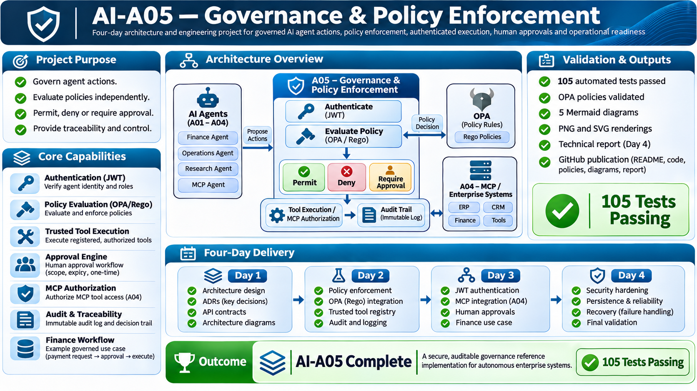

# AI-A05 — Governance & Policy Enforcement




AI-A05 is a small, local reference implementation of policy enforcement for agent requests. It demonstrates authenticated policy evaluation, a server-owned simulated tool registry, an A05-to-A04 MCP adapter, finance approvals, and structured audit records. It is not a production platform.

## Current implementation

- FastAPI endpoints authenticate RS256 JWTs against a configured public key, issuer, audience, expiry, and required claims.
- OPA/Rego evaluates finance and MCP decisions. The protected finance tool path fails closed if evaluation or required pre-execution auditing fails.
- Tool handlers are server registered. Finance approvals are bound to requester, action, resource, amount, and currency, expire, prevent self-approval, and can be consumed once.
- Approval state and lifecycle events persist in a local SQLite database (`runtime/approvals.sqlite3` by default). JSONL execution audit files are local evidence, not tamper-resistant storage.
- The A04 adapter is deliberately limited to the synthetic `get_customer` lookup and validates its exact arguments before invoking A04.
- All finance operations use a simulation. No real payment is submitted.

## Trust boundary and limitations

A05 can enforce its checks only on requests that pass through A05. A04 remains independently runnable and its development policy reads `AI_A04_ROLE` from the process environment. A client that can launch or reach A04 directly can set that variable; A05's adapter-side authorization does not secure that entry point. Closing this boundary requires an A04-side change: remove client-selected roles, authenticate A05-issued identity or a mutually authenticated service identity at A04, and enforce tool/action/argument authorization inside A04 for every transport. This repository does not modify A04.

See [the Day 4 security and operations report](docs/reports/AI-A05-Day-4-Security-and-Operational-Readiness.md) for the threat model, control evidence, startup/recovery steps, and remaining gaps. See the [architecture specification](docs/AI-A05-Architecture-Specification.md) for the design notes.

## Infographics

| Day | Infographic |
|---|---|
| Day 1 | [AI Governance Architecture](infographics/ai-a05-1-AI%20Governance%20Architecture%20Infographic.png) |
| Day 2 — variant 1 | [AI Governance Architecture](infographics/ai-a05-2-1-AI%20Governance%20Architecture%20Infographic.png) |
| Day 2 — variant 2 | [AI Governance Day 2](infographics/ai-a05-2-2-AI%20Governance%20Day%202%20Infographic.png) |
| Day 3 | [AI Governance Day 3](infographics/ai-a05-3-AI%20Governance%20Day%203%20Infographic.png) |
| Day 4 | [AI Security Readiness](infographics/ai-a05-4%20AI%20Security%20Readiness%20Day%204.png) |

## Architecture diagrams

These five diagrams describe the implemented local prototype and its known trust boundaries. Each source is available as Mermaid, PNG, and SVG in `diagrams/` and `diagrams/rendered/`.

| Diagram | Mermaid source | PNG | SVG |
|---|---|---|---|
| System context | [01-system-context.mmd](diagrams/01-system-context.mmd) | [PNG](diagrams/rendered/01-system-context.png) | [SVG](diagrams/rendered/01-system-context.svg) |
| Component architecture | [02-component-architecture.mmd](diagrams/02-component-architecture.mmd) | [PNG](diagrams/rendered/02-component-architecture.png) | [SVG](diagrams/rendered/02-component-architecture.svg) |
| Policy and execution sequence | [03-policy-decision-sequence.mmd](diagrams/03-policy-decision-sequence.mmd) | [PNG](diagrams/rendered/03-policy-decision-sequence.png) | [SVG](diagrams/rendered/03-policy-decision-sequence.svg) |
| Approval lifecycle | [04-approval-lifecycle.mmd](diagrams/04-approval-lifecycle.mmd) | [PNG](diagrams/rendered/04-approval-lifecycle.png) | [SVG](diagrams/rendered/04-approval-lifecycle.svg) |
| Audit and operational recovery | [05-audit-operational-recovery.mmd](diagrams/05-audit-operational-recovery.mmd) | [PNG](diagrams/rendered/05-audit-operational-recovery.png) | [SVG](diagrams/rendered/05-audit-operational-recovery.svg) |

## Local setup

Use Python 3.12 and install the declared development dependencies:

```bash
python -m pip install -e ".[dev]"
```

Set `A05_JWT_PUBLIC_KEY` to a readable PEM public key trusted by your test token issuer. Do not put private keys or tokens in the repository. Run locally on loopback:

```bash
uvicorn src.api.main:app --host 127.0.0.1 --port 8000
```

Set `A05_APPROVAL_DB` to override the SQLite approval database path. Runtime state is ignored by Git. Stop the service with Ctrl-C before copying or restoring its SQLite database; see the report for safe backup and recovery instructions.

## Validation

```bash
python -m pytest -v
tools/opa_linux_amd64 check policies
python -m pip check
git diff --check
```

## Security posture

The code and tests demonstrate selected local controls. They do not demonstrate production key management, distributed/revocation-aware identity, a tamper-evident audit service, high availability, multi-host atomic approval, execution sandboxing, or comprehensive MCP gateway enforcement. SQLite is single-host prototype persistence. Continue to treat the service and all returned policy decisions as untrusted until deployed behind independently secured execution boundaries.
